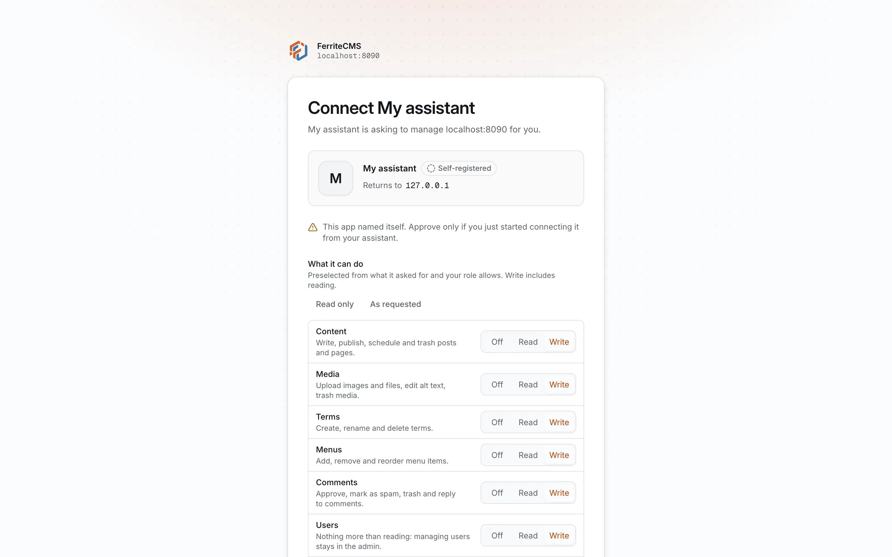
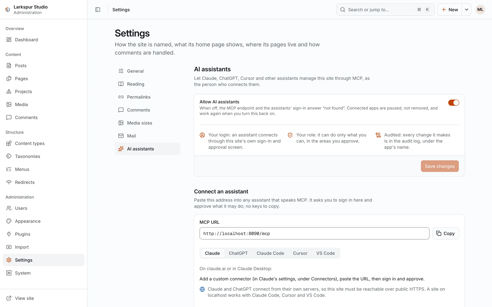
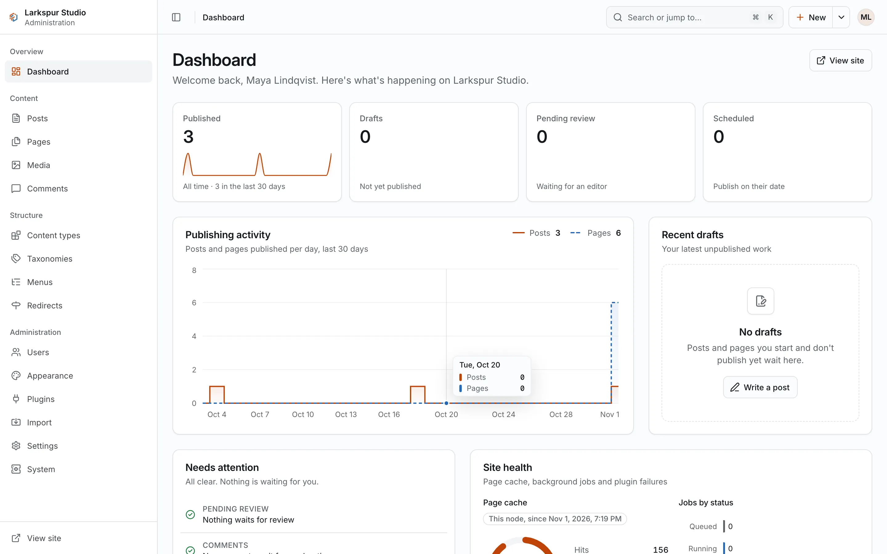
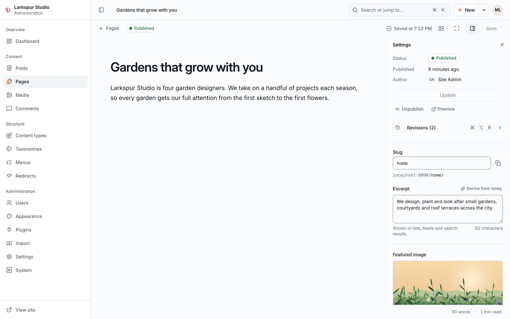
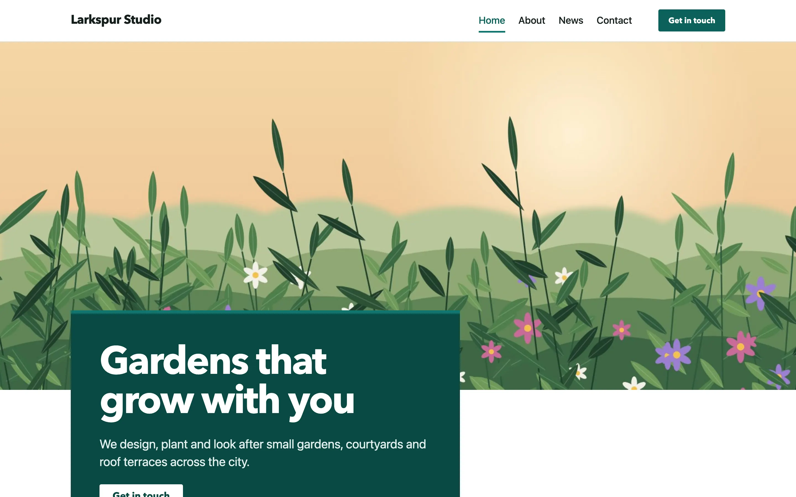
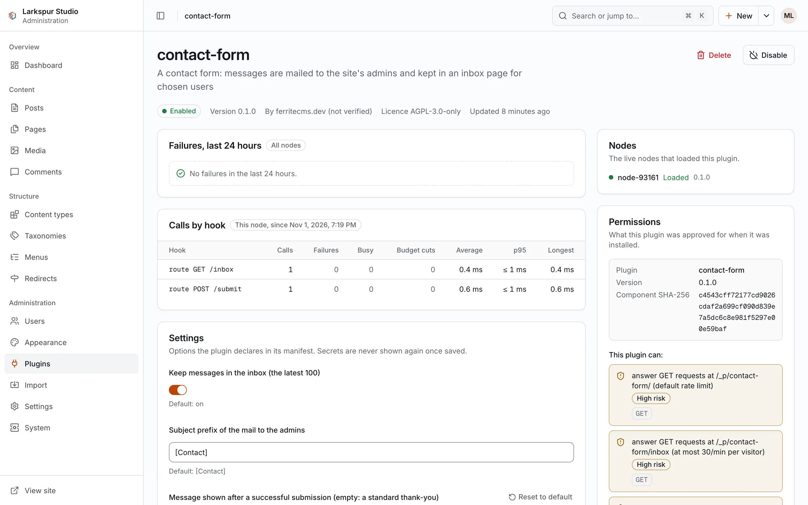
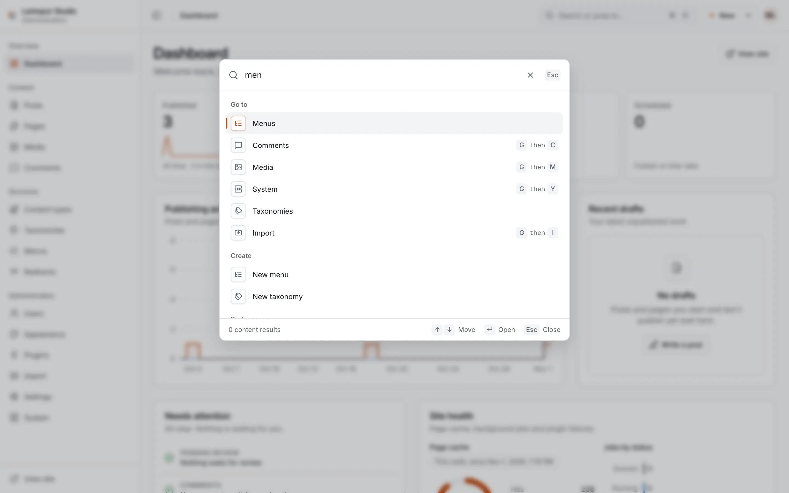

<p align="center">
  <picture>
    <source media="(prefers-color-scheme: dark)" srcset="docs/brand/ferrite-logo-horizontal-dark.svg">
    
  </picture>
</p>

<p align="center">

[](https://github.com/softberries/ferritecms/actions/workflows/ci.yml)
[](https://github.com/softberries/ferritecms/releases)
[](LICENSE)

</p>

A WordPress-style CMS shipped as **one Rust binary**, where every plugin runs in a
**WebAssembly sandbox** and can only do what it declared.

- **Run it from your AI assistant**: every site serves an MCP endpoint. Connect Claude,
  ChatGPT, Claude Code, Cursor or VS Code and ask it to write, publish, organise and check
  your site, as you, with your permissions; changes are recorded in the audit log under
  the app's name.
- **Single binary, single folder**: web server, admin, themes, plugin runtime and SQLite
  are compiled in (Postgres and S3 are optional, for several nodes). Back up or move a site
  by copying one folder.
- **Sandboxed plugins**: WebAssembly components with a permission manifest and memory,
  CPU and time limits on every call. A broken plugin can't take the site down or read your
  users table.
- **Familiar to WordPress developers**: hooks with priorities, a template hierarchy, post
  types, roles.
- **Brings your WordPress content**: posts, pages, media, taxonomies, users, comments,
  menus and 301 redirects from a WXR export.
- **Multilingual**: up to 20 languages, each translation its own item, `/de/` style
  addresses, hreflang links, per-language menus and feeds, and a language switcher in the
  built-in themes.

**Documentation: [softberries.github.io/ferritecms](https://softberries.github.io/ferritecms/)** · Built by [SOFTBERRIES](https://softberries.dev)

## Manage your site with AI

Every FerriteCMS site serves a [Model Context Protocol](https://modelcontextprotocol.io)
endpoint at its address plus `/mcp`. Connect your assistant, sign in to your site once,
approve what it may do, and ask:

> Publish a post about our spring opening hours and add it to the main menu.

The two quickest ways to connect:

- **Claude Code**, which also works with a site on `localhost`:

  ```sh
  claude mcp add --transport http ferrite http://localhost:8080/mcp
  ```

  then run `/mcp` in Claude Code, choose the `ferrite` server and follow the browser
  sign-in; your browser opens the site's consent screen.
- **Claude** (claude.ai, Claude Desktop) or **ChatGPT**, for a site on public HTTPS: add
  `https://your-site/mcp` as a custom connector (Claude) or as a developer-mode connector
  with OAuth (ChatGPT), then sign in and approve.

Cursor, VS Code and any other MCP client work too; a personal API token in an
`Authorization` header replaces the sign-in for scripts. 56 tools cover posts and pages,
media, terms, menus, content types, redirects, comments, settings, themes, plugins and the
site's health. The assistant acts as you: through your site's own sign-in and consent
screen, with your role narrowed to the areas you approve, and its changes are recorded in
the audit log under the app's name. Installing plugins, managing users and tokens, imports
and backups stay with people.
[Guide](https://softberries.github.io/ferritecms/guides/ai-assistants/) ·
[Every tool](https://softberries.github.io/ferritecms/reference/mcp-tools/)

| Connecting an assistant | Settings → AI assistants |
|---|---|
|  |  |

<p align="center">
  
</p>

| The editor | Your site (the `business` theme) |
|---|---|
|  |  |
| **Plugins and their permissions** | **The command palette** |
|  |  |

## Quickstart

Download a release for your platform from
[Releases](https://github.com/softberries/ferritecms/releases), unpack it and start a site:

```sh
VERSION=0.2.0
TARGET=x86_64-unknown-linux-gnu   # or aarch64-unknown-linux-gnu, *-linux-musl, aarch64-apple-darwin, x86_64-apple-darwin
curl -LO https://github.com/softberries/ferritecms/releases/download/v$VERSION/ferrite-$VERSION-$TARGET.tar.gz
tar -xzf ferrite-$VERSION-$TARGET.tar.gz
cd ferrite-$VERSION-$TARGET

./ferrite init --data ./mysite --url http://localhost:8080
./ferrite seed demo --data ./mysite        # optional: sample posts, pages and menus
./ferrite user create --data ./mysite --login me --email me@example.com
./ferrite serve --data ./mysite
```

The site is at <http://localhost:8080> and the admin at <http://localhost:8080/admin/>.
`user create` prints a one-time password, which you change at the first sign-in.

Every release's `SHA256SUMS` is signed with minisign. [Install](https://softberries.github.io/ferritecms/getting-started/install/)
shows how to check a download.

### Docker

```sh
IMAGE=ghcr.io/softberries/ferritecms:0.2.0
docker run --rm -v ferrite-data:/data $IMAGE init --data /data --url http://localhost:8080
docker run --rm -v ferrite-data:/data $IMAGE user create --data /data --login me --email me@example.com
docker run -d --name ferrite -p 8080:8080 -v ferrite-data:/data \
  -e FERRITE_SERVER__LISTEN=0.0.0.0:8080 $IMAGE
```

### From source

Rust (stable, through [rustup](https://rustup.rs)), Node.js 24.18 or newer and pnpm 10.28.2:

```sh
git clone https://github.com/softberries/ferritecms.git
cd ferritecms
pnpm -C admin install && pnpm -C admin build   # the admin is embedded in the binary
cargo build --release --locked -p ferrite
./target/release/ferrite --version
```

## Move a WordPress site

Export the site in WordPress (Tools → Export), then:

```sh
./ferrite import wordpress export.xml --data ./mysite --uploads ./wp-content/uploads
```

`--uploads` takes a copy of `wp-content/uploads` or a `.zip` of it; `--fetch-media`
downloads the media from the old site instead. The import writes a report of everything
it converted, skipped or redirected. The admin's Import screen does the same while the
site runs. See [Import from WordPress](https://softberries.github.io/ferritecms/guides/import-wordpress/).

## What's in 0.2.0

New in 0.2.0:

- AI assistants over MCP: an endpoint at `/mcp` on every site, OAuth sign-in through the
  site's own consent screen, 56 tools, and the admin's consent screen, Connected apps list
  and AI assistants settings.
- A redesigned documentation site with search, hosted on GitHub Pages.

From 0.1.0, the first release:

- The public site with three starter themes (`blog`, `docs`, `business`), RSS feeds,
  sitemaps and a page cache.
- The admin: a rich-text editor with autosave and revisions, media library, content types with
  custom fields, taxonomies, menus, comments, users, settings, themes, plugins and system
  status.
- A REST API under `/api/v1` with an OpenAPI spec, sessions, scoped API tokens and TOTP.
- Plugins in a capability-scoped WebAssembly sandbox, with three examples (SEO, analytics,
  a contact form) shipped as a release asset.
- Imports from WordPress (WXR) and from a folder of Markdown files.
- Backups, restores, exports and media maintenance; signed `self-update` with rollback;
  built-in HTTPS (ACME) for single-node sites; Prometheus metrics; `ferrite doctor`.
- Two ways to run it: **solo** (SQLite and local media, one node) or **cluster**
  (Postgres and S3-compatible storage, several nodes).

It is an early release: expect changes before 1.0. Plans and open items are in
[`docs/ROADMAP.md`](docs/ROADMAP.md).

## Documentation and design

- The [documentation site](https://softberries.github.io/ferritecms/) covers getting
  started, guides, operations, plugin and theme authoring, and a CLI reference. It is
  written in [`site/`](site/) and built with FerriteCMS itself.
- Running a site: [`packaging/systemd/`](packaging/systemd/README.md),
  [`docs/operations/solo-upgrade.md`](docs/operations/solo-upgrade.md) and
  [`docs/operations/cluster-runbook.md`](docs/operations/cluster-runbook.md).
- The product brief is [`docs/BRIEF.md`](docs/BRIEF.md) and the technical design is in
  [`docs/design/`](docs/design/) (start with `00-overview.md`).

## Repository layout

| Path | What it holds |
|---|---|
| `crates/` | The Rust workspace: the `ferrite` binary and its libraries (HTTP, core, storage, plugin host, themes, importers) |
| `admin/` | The admin, a React app embedded in the binary |
| `themes/` | The starter themes (embedded) |
| `plugins/examples/` | The example plugins and the plugin host's test fixtures |
| `wit/` | The plugin API (WIT), the source of truth for plugins |
| `site/` | The documentation site's Markdown and build scripts |
| `docs/` | Brief, design, roadmap and runbooks |

## Contributing

Issues and pull requests are welcome; before a larger change, open an issue to discuss it.
The build and test commands are in [CONTRIBUTING.md](CONTRIBUTING.md).

Because FerriteCMS is offered under the AGPLv3 and under a commercial license, contributors
sign a Contributor License Agreement on their first pull request (CLA assistant asks for
it). See [CONTRIBUTING.md](CONTRIBUTING.md) and [LICENSING.md](LICENSING.md).

## Commercial license

FerriteCMS is built by [SOFTBERRIES](https://softberries.dev). A commercial license, which
removes the AGPL obligations, is available on request. Contact
**[hello@softberries.dev](mailto:hello@softberries.dev)** or visit
**[softberries.dev](https://softberries.dev)**.

## License

FerriteCMS is licensed under the [GNU Affero General Public License v3.0 only](LICENSE)
(`AGPL-3.0-only`). If you run a modified version for other people over a network, you must
offer them its source. A commercial license is available as well; see
[LICENSING.md](LICENSING.md).

Plugins and themes are separate: an [additional permission](LICENSE-EXCEPTION.md) lets
you license a plugin or theme you write under any terms you like, including one built with
the plugin SDK or copied from the example plugins or starter themes. This summary is not
legal advice.
