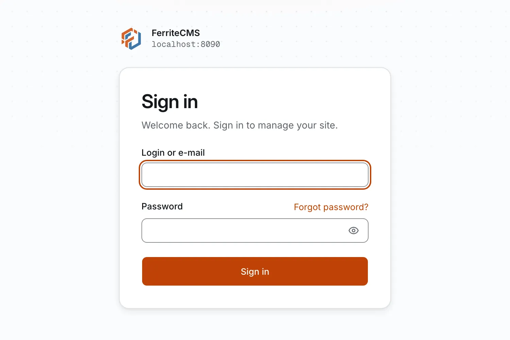
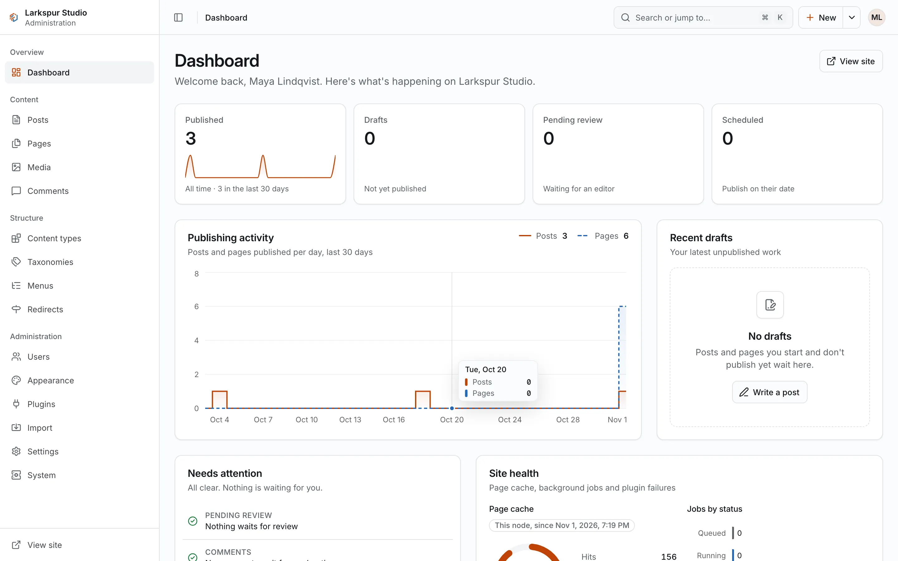
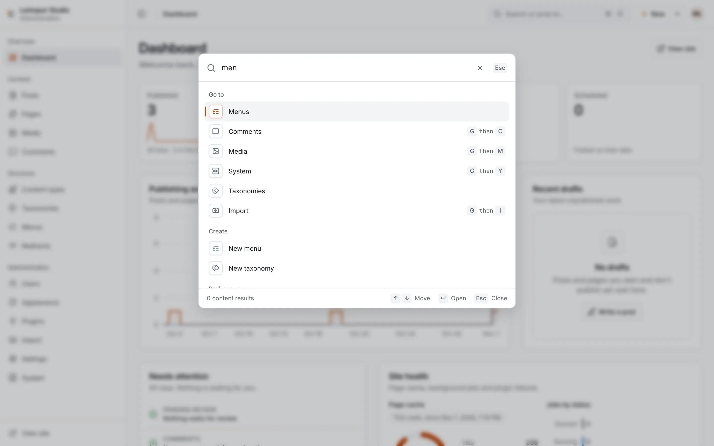
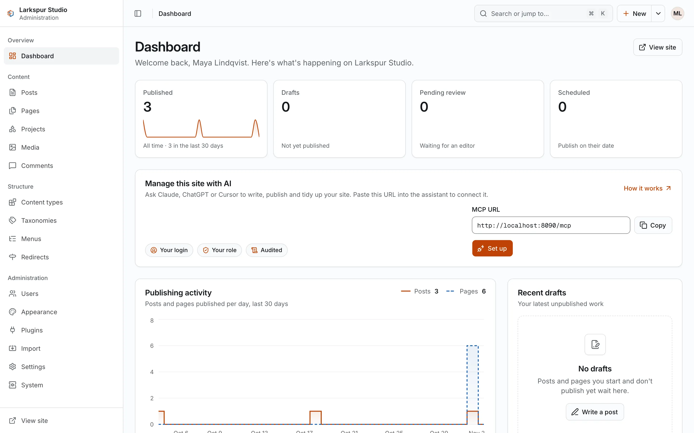

+++
description = "Create a data folder, add an admin account, start the server and sign in."
+++

# Your first site

A site is one **data folder**. It holds the configuration, the database, the media files
and the site key. These steps make a solo site (SQLite and local media) in the folder
`./mysite`.

## Create the data folder

```sh
ferrite init --data ./mysite --url http://localhost:8080
```

`--url` is the public address of the site, used for the absolute links in the page head,
the feed and the sitemap. Use the
real address (`https://example.com`) for a public site. `--title` sets the site title
(default `My Site`).

`init` creates:

| Path | What it is |
|---|---|
| `mysite/ferrite.toml` | the configuration (mode 0600, as it can hold database and mail credentials) |
| `mysite/ferrite.db` | the SQLite database, with every migration applied |
| `mysite/media/` | the media store: uploaded files, their resized copies, and the files of installed themes and plugins |
| `mysite/backups/` | snapshots taken before each schema upgrade |
| `mysite/secret.key` | the site key that seals stored secrets (mode 0600; never printed) |

A new data folder gets mode 0750. `init` refuses to overwrite an existing `ferrite.toml` or
database.

## Add an admin account

`init` creates no user. Create the first admin:

```sh
ferrite user create --data ./mysite --login me --email me@example.com
```

It prints a one-time password, once. You must change it at the first sign-in. To set the
password yourself, pipe it in with `--password-stdin` (at least 12 characters, at most 1024 bytes):

```sh
printf '%s\n' "$PASSWORD" | ferrite user create --data ./mysite --login me --email me@example.com --password-stdin
```

`--role` picks `admin` (the default), `editor`, `author` or `contributor`.

## Add sample content (optional)

```sh
ferrite seed demo --data ./mysite
```

This adds 12 posts, three pages, categories, tags, two menus and a sample image. It also
creates a user `admin` that has no password; you do not need it.

`--profile business` writes a small business site instead: a front page with three
service pages, About and Contact pages, three news posts, two menus and four images. It
is made for the `business` theme, so activate that too:

```sh
ferrite seed demo --data ./mysite --profile business
ferrite theme activate business --data ./mysite
```

<figure><figcaption>The business demo site in the <code>business</code> theme.</figcaption></figure>

## Start the server

```sh
ferrite serve --data ./mysite
```

It prints `Listening on http://127.0.0.1:8080`. The site is at
[http://localhost:8080/](http://localhost:8080/). Stop it with Ctrl-C.

By default the server listens on `127.0.0.1:8080`. To change that, set `listen` in the
`[server]` section of `ferrite.toml`, or set the variable `FERRITE_SERVER__LISTEN` for one
run. Every setting can be overridden this way: `FERRITE_<SECTION>__<KEY>`.

## Sign in to the admin

Open [http://localhost:8080/admin/](http://localhost:8080/admin/) and sign in with the
login (or e-mail) and the one-time password. The admin asks for a new password first, then
opens the dashboard. Press `⌘K` (`Ctrl+K` on Linux and Windows) for the command palette: it searches
content, jumps to a screen, creates something or changes a preference.

<figure><figcaption>The sign-in screen.</figcaption></figure>

<figure><figcaption>The dashboard of a site made with <code>seed demo --profile business</code>.</figcaption></figure>

<figure><figcaption>The command palette: type to find a screen, an action or content.</figcaption></figure>

## Connect an AI assistant

The site is ready to be run from an AI assistant. Its MCP address is the site's URL plus
`/mcp`: here `http://localhost:8080/mcp`. The dashboard shows it, and
**Settings → AI assistants** has the steps for each client. On a local site, use an
assistant that runs on your computer, such as Claude Code:

```sh
claude mcp add --transport http ferrite http://localhost:8080/mcp
```

Then run `/mcp` in Claude Code, pick `ferrite` and choose **Authenticate**. Your browser
opens the site's consent screen: approve, and ask Claude Code something like "List the
drafts on my site" or "Write a short post about our opening hours, as a draft". Claude
(claude.ai and Claude Desktop) and ChatGPT connect from their own servers, so they need
the site on a public `https` address. See [AI assistants (MCP)](../02-guides/08-ai-assistants.md).

<figure><figcaption>Until an assistant is connected, the dashboard shows the address to paste.</figcaption></figure>

## Stop the server for maintenance commands

With SQLite, `serve` holds a lock on the data folder. While it runs, commands that open the
database (`user`, `seed`, `theme`, `plugin`, `import`, `migrate`) fail with a message that
the folder is in use. Stop the server, run the command, start it again. With Postgres there
is no folder lock.

## Check the configuration

```sh
ferrite config check --data ./mysite
```

It reads `ferrite.toml` and the `FERRITE_*` variables exactly as `serve` does, without
opening the database, and prints one line such as
`ok: mode=solo database=sqlite media=local workers=… mail=off metrics=off tls=off backup=off`,
or the list of problems.

## Next

Read the [concepts](03-concepts.md), then start [writing](../02-guides/01-writing.md), in
the admin or [from your AI assistant](../02-guides/08-ai-assistants.md).
