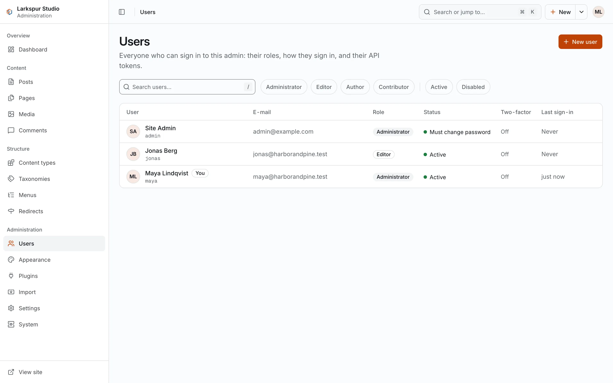

+++
description = "Content types, items, terms, menus, media, themes, plugins, roles and AI assistants."
+++

# Concepts

FerriteCMS uses the same ideas as WordPress. This page names them and says where each one
lives in the admin.

## Content types and items

Everything you write is an **item** of a **content type**. Three types are built in:

| Type | Hierarchical | Default address |
|---|---|---|
| `post` (Posts) | no | `/<slug>/` |
| `page` (Pages) | yes: a page can have a parent | `/<parent>/<slug>/` |
| `media` (Media) | no | the file at `/_media/<hash>/<name>` |

You can add your own types (for example `recipe` or `product`), with their own fields. Their
items live under `/<type>/<slug>/`. See [Content types](../02-guides/03-content-types.md).

An item has a title, a slug, a body, an excerpt, an author, a status and, depending on the
type, a parent, an order, a featured image, custom fields and SEO fields. The body is
stored as a tree of blocks (paragraphs, headings, lists, images, tables and so on), not as
raw HTML; the theme turns it into HTML.

The statuses an editor sees are **draft**, **pending** (submitted for review),
**scheduled** (publishes at a set time), **published** and **trash**. Only published items
are on the public site.

## Taxonomies and terms

A **taxonomy** groups items; its entries are **terms**. Two are built in, both for posts:

- `category`: nested (a category can have a parent), at `/category/<slug>/`;
- `tag`: flat, at `/tag/<slug>/`.

You can add taxonomies and choose which content types use them.

## Menus

A **menu** is a named, nested list of links: to items, to terms or to any URL. A theme
declares **menu locations** (the built-in themes have `primary` and `footer`), and you pick
which menu shows in each location.

## Media

Uploads are media items. Images get resized copies in the background, and themes ask for
the sizes they need. See [Media](../02-guides/02-media.md).

## Themes

A **theme** decides how the public site looks: templates written in MiniJinja (a Jinja2
dialect), CSS and other assets, and optional settings such as an accent colour. Exactly
one theme is active. A theme cannot run code on the server; it gets data from core and a
fixed set of helpers. See [Themes](../02-guides/04-themes.md).

## Plugins

A **plugin** adds behaviour: it can change the page head, filter content, answer its own
routes under `/_p/<plugin>/`, store data or send mail to the site's admins. A plugin is a
WebAssembly component plus a manifest, `ferrite-plugin.toml`, that lists what it may do.
You approve that list when you install it. See [Plugins](../02-guides/05-plugins.md).

## Users and roles

Every account has one role:

<figure><figcaption>Users and their roles, under <strong>Users</strong>.</figcaption></figure>

| Role | Can |
|---|---|
| contributor | write their own items while they are drafts or pending, and submit them for review |
| author | publish their own items and upload media |
| editor | edit and publish everyone's items; manage terms, menus and comments |
| admin | everything, including users, settings, themes, plugins, imports, redirects and the system screens |

Each role includes what the roles above it in this table can do.

## AI assistants

An **AI assistant** (Claude, ChatGPT, Claude Code, Cursor, VS Code or another MCP client)
connects to the site's MCP endpoint, `/mcp`, and manages the site through **tools**: one
per job, such as `content_create`, `menu_set` or `comment_moderate`. It signs in as a
user, through the site's consent screen, and gets that user's role narrowed to the areas
the user approved. Its changes go through the same checks as the admin's and are recorded
in the audit log under the app's name. Connected apps are listed under
**Account → Connected apps**. See [AI assistants (MCP)](../02-guides/08-ai-assistants.md).

## The data folder

A solo site keeps everything in its data folder: `ferrite.toml`, `ferrite.db`, `media/`,
`backups/` and `secret.key`. Copying that folder, with the server stopped, copies the site.
