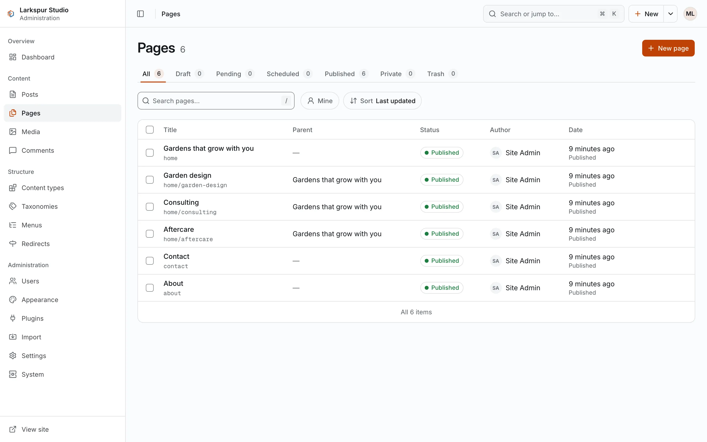
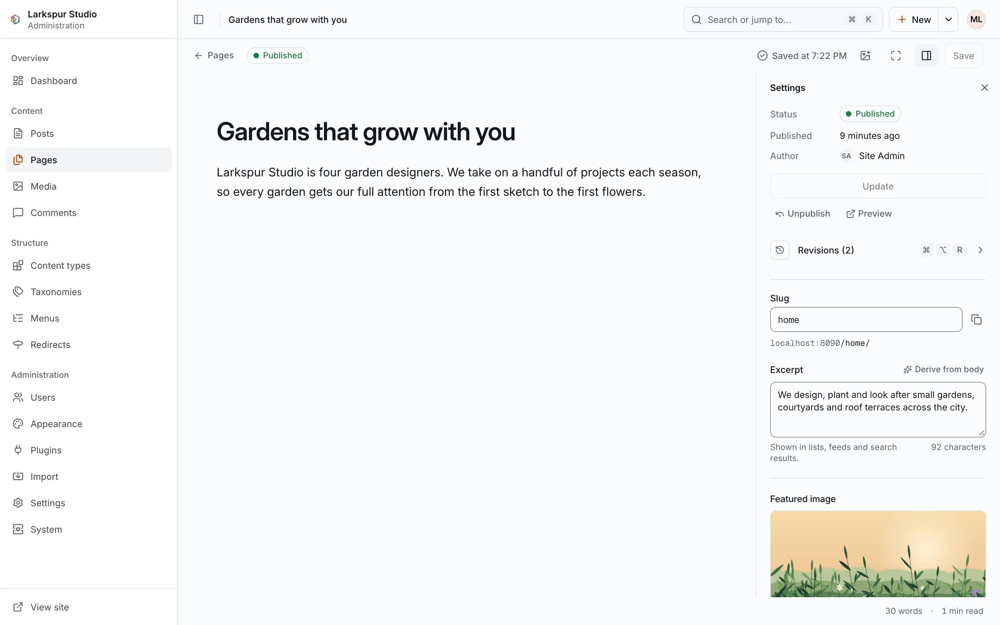

+++
description = "The editor, publishing and scheduling, autosave, revisions and previews."
+++

# Writing and publishing

Posts, pages and items of your own types are all written in the same editor.

## Create an item

Open **Posts** (or **Pages**, or your type) in the sidebar and choose **New post** (or
**New page**, **New entry**), or use the **New** menu in the top bar. The list screens have
a tab per status, a search, a **Mine** filter for your own items and a filter per
taxonomy.

<figure><figcaption>A content list. Each content type has one, under <strong>Content</strong>.</figcaption></figure>

## The editor

The editor shows the title and the body. In the body, type `/` to insert a block:

<figure><figcaption>The editor and its settings panel.</figcaption></figure>

- headings (levels 2 to 4), bulleted and numbered lists, quotes, code blocks, tables and
  dividers;
- **Image**, from the media library;
- **Embed**, a YouTube or Vimeo video;
- **HTML block**, raw markup that the site sanitises when it renders it.

Select text for the formatting bar: bold, italic, strikethrough, inline code, link,
headings and quote.

The **side panel** (`⌘.` / `Ctrl+.`) holds everything else: status and publish time,
author, slug and address, excerpt, categories and tags, parent and order for pages, the
featured image, custom fields and the SEO fields.

| Shortcut | Action |
|---|---|
| `⌘S` / `Ctrl+S` | save |
| `⌘.` / `Ctrl+.` | show or hide the side panel |
| `⌘⇧P` / `Ctrl+Shift+P` | open the publish dialog |
| `⌘⌥R` / `Ctrl+Alt+R` | open the revisions |
| `⌘⇧F` / `Ctrl+Shift+F` | focus mode |

## Save, autosave and conflicts

**Save** writes the item. In between, the editor **autosaves** every 10 seconds while you
type, into a private slot of yours; the item itself does not change until you save. When
you open an item whose slot holds unsaved work, the editor offers it back with a banner,
and you can restore or discard it.

If someone else saved the item while you were editing, your save is refused and a dialog
shows both versions side by side. You can keep yours, take theirs (yours stays in your
slot) or copy your text.

## Publish or schedule

The publish dialog offers **Now** or **Later**. Later takes a date and a time on your
browser's clock, shows its time zone, and refuses a time in the past. A scheduled item
goes live by itself at that time; until then the panel offers **Unschedule**.

What you may do depends on your role:

- authors, editors and admins can publish their own items (editors and admins anyone's);
- contributors **Submit for review**, which sets the item to pending. An editor or admin
  publishes it.

**Unpublish** takes a published item back to draft.

## Preview

**Preview** in the side panel opens the item as the site will show it, in a new tab, at
`/_preview/<id>`. It shows the **saved** item, so save first to see your latest changes.
Previews work only for a signed-in user who may read the item, are never cached, and tell
search engines not to index them.

## Revisions

Every save keeps a revision; the newest 50 of each item are kept. Open them with
**Revisions** in the side panel or `⌘⌥R`. Each revision is shown against the current item
as a word diff, and **Restore** brings it back (with an undo).

## Trash

**Move to trash** in the side panel, or in a list's row menu, moves an item to the trash,
with an undo. From the list's Trash tab you can restore it (as a draft) or delete it
permanently.
Contributors cannot restore or delete items.
