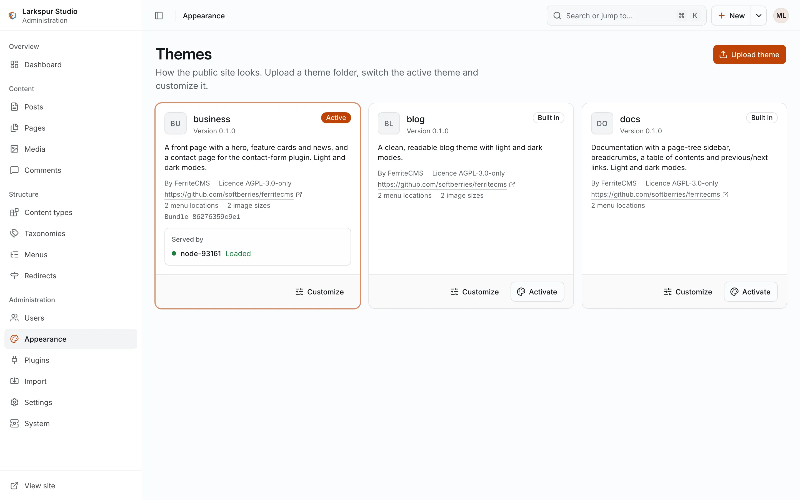

+++
description = "The three built-in themes, activating and customising a theme, and installing your own."
+++

# Themes

A theme sets how the public site looks. It is a folder of templates, CSS and assets with a
`theme.toml` manifest. Themes cannot run code on the server: templates get data from core
and a fixed set of helpers, and anything that needs logic belongs in a plugin.

## The built-in themes

Three themes are compiled into the binary. Each uses plain CSS with no build step and
follows the visitor's light or dark setting. They are licensed like FerriteCMS
(`AGPL-3.0-only`), with a permission to copy them into a theme of your own under any license
(`LICENSE-EXCEPTION.md` in the repository).

| Theme | For | Settings |
|---|---|---|
| `blog` (the default) | a blog: posts, pages, categories, tags and comments | accent colour, show post authors, show excerpts in listings |
| `docs` | documentation: a page-tree sidebar, breadcrumbs, a table of contents and previous/next links | accent colour, the content type shown in the sidebar, show the table of contents, show the "updated" date |
| `business` | a small business: a front page with a hero, feature cards and news, and a contact page | accent colour, call-to-action text and link, show the latest news, show the contact form |

All three have two menu locations, `primary` and `footer`.

- **docs** shows the tree of one content type (`page` by default) in the sidebar, in the
  pages' order. These docs use it.
- **business** shows the front page's child pages as cards on the front page. Its contact
  page (the page with the slug `contact`) can embed the
  [contact-form plugin](05-plugins.md)'s form; turn on its **contact form** setting after
  installing and enabling the plugin. `ferrite seed demo --profile business` writes sample
  content shaped for it.

## Activate a theme

In the admin, open **Appearance**, find the theme's card and choose **Activate**. Each
running node loads the new theme and flushes its page cache; the admin waits until every
node reports it.

<figure><figcaption><strong>Appearance → Themes</strong> lists the installed themes.</figcaption></figure>

Or from the command line (with SQLite, stop `serve` first):

```sh
ferrite theme list --data ./mysite
ferrite theme activate --data ./mysite docs
```

A theme that does not load is refused, and the active theme stays as it was.

## Customise a theme

A theme with settings has **Customize** on its card. The form shows the theme's settings
(colours, switches, text); saving refreshes every page of the site. Menus are set under
**Structure → Menus**, per location.

To change a theme's templates or CSS, copy its folder (the built-in ones are in the
repository under `themes/`), give it a new `name` in `theme.toml`, edit it, and install
it as below.

## Install a theme

From a folder, with the command line (with SQLite, stop `serve` first):

```sh
ferrite theme install --data ./mysite --dir ./my-theme --activate
```

Or in the admin: **Appearance → Upload theme**, then choose or drop the folder. The admin
packs it in the browser and uploads it. You can also upload a bundle made with:

```sh
ferrite theme pack --dir ./my-theme --out my-theme.tar
```

Every template is compiled before anything is stored; a theme with an error is refused
with the file and line of each problem. Uploading a theme with the name of an installed
one replaces it, and if it is active, the new files go live at once. A theme may hold at
most 2000 files and 20 MiB.
