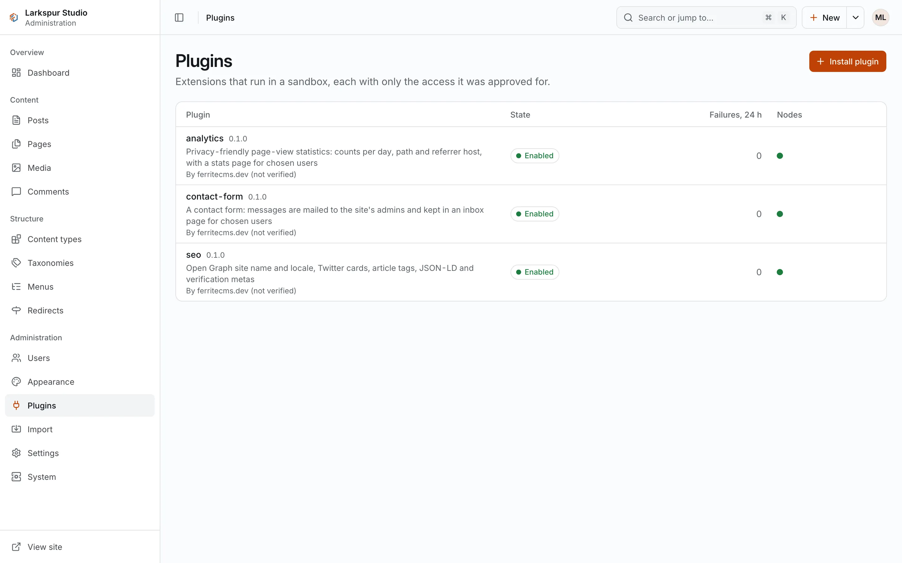
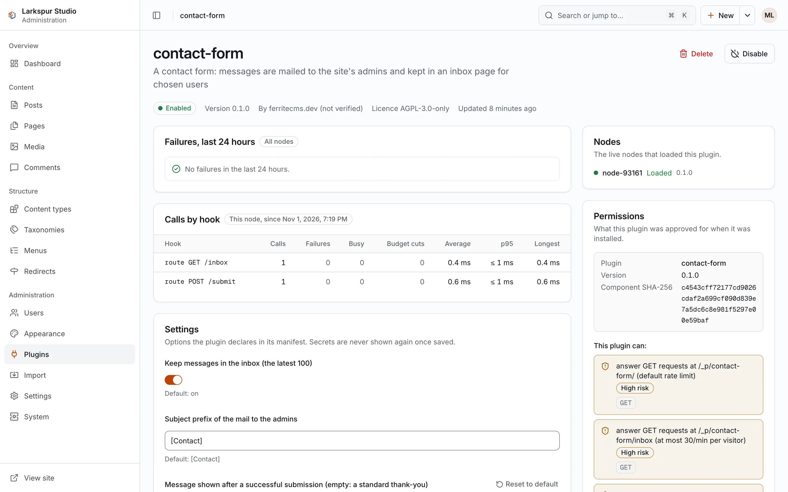
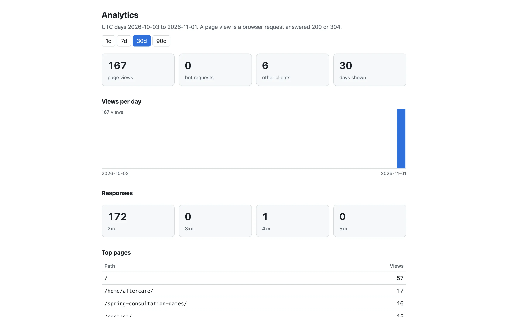

+++
description = "Install a plugin after reading its permission report, change its settings, and try the three example plugins."
+++

# Plugins

A plugin is a folder with two files: the manifest `ferrite-plugin.toml` and one
WebAssembly component (`*.wasm`). The manifest lists the **capabilities** the plugin asks
for, such as reading published posts, adding tags to the page head, answering its own
routes under `/_p/<plugin>/`, keeping data, or mailing the site's admins. The plugin gets
only what it lists and nothing else: no SQL, no files, no network unless declared.

Every call into a plugin is limited in memory, in fuel (the amount of work) and in time.
A call that fails or runs over is ignored, and the page renders as if that plugin had not
run. A plugin that
fails 20 times within 10 minutes (the defaults of `disable_after_failures` and
`failure_window` in `[plugins]`) is disabled automatically, with the reason shown in the
admin.

## The permission report

Before anything is installed, FerriteCMS reads the manifest and the component and prints
a **permission report**: the component's SHA-256, one line per capability and per action
hook (`!` marks a high risk, `~` a medium one), any limits the manifest sets, and a
`fingerprint`. You approve exactly that report. An update that asks for more than the
installed version lists what it adds, and needs a new approval.

## Install from the command line

With SQLite, stop `serve` first. Check the folder, which prints the report and stores
nothing:

```sh
ferrite plugin check --data ./mysite --dir ./seo-plugin
```

Then install it:

```sh
ferrite plugin install --data ./mysite --dir ./seo-plugin --enable
```

`install` prints the report again and asks `install? [y/N]`. `--yes` approves without
asking (required when the input is not a terminal). A new plugin is installed disabled
unless you pass `--enable`. Other commands:

```sh
ferrite plugin list --data ./mysite
ferrite plugin enable --data ./mysite seo
ferrite plugin disable --data ./mysite seo
ferrite plugin remove --data ./mysite seo
```

## Install in the admin

Open **Plugins** and choose **Install plugin**. Pick (or drop) the `ferrite-plugin.toml`
and the `.wasm`; the admin shows the permission report, with high-risk items first, and
**Approve and install** installs it. A new plugin is installed disabled; the last step
offers **Enable**.

<figure><figcaption>The installed plugins.</figcaption></figure>

<figure><figcaption>A plugin's page: its permissions, settings and metrics.</figcaption></figure>

## Settings

A plugin's settings are on its page in the admin (**Plugins**, then the plugin). Secret
settings are write-only: the admin never shows a stored secret back. The plugin page also
shows its failures per hook over the last 24 hours and its call times.

## Remove a plugin

Removing a plugin keeps its stored data and settings for 30 days, so reinstalling it
within that time finds them. To erase them at once, use `--purge`
(`ferrite plugin remove --data ./mysite seo --purge`) or **Delete and erase data** in the
admin.

## The example plugins

The repository has three example plugins under `plugins/examples/`, each with a README
that lists its capabilities and settings:

<figure><figcaption>The <code>analytics</code> plugin's stats page at <code>/_p/analytics/</code>.</figcaption></figure>

| Plugin | What it does | Capabilities |
|---|---|---|
| `seo` | adds the head tags core does not emit: Open Graph site name and locale, Twitter cards, article tags, JSON-LD, search-engine verification tags and the feed link | read posts, read two options, add to the page head |
| `analytics` | counts page views per day, path and referrer host, without cookies or IP addresses, and shows them at `/_p/analytics/` to the users you list | its own storage, routes, read one option, the batched request events |
| `contact-form` | a contact form whose messages are mailed to the site's admins and kept in an inbox at `/_p/contact-form/inbox` | routes, its own storage, mail to admins, read one option |

Each release carries them as `ferrite-plugins-<version>.tar.gz` (folders `seo/`,
`analytics/` and `contact-form/`, each ready for `ferrite plugin install --dir`). To build
one from a clone of the repository instead:

```sh
cargo build --release --target wasm32-wasip2 --manifest-path plugins/Cargo.toml -p seo
mkdir seo-plugin
cp plugins/examples/seo/ferrite-plugin.toml seo-plugin/
cp plugins/target/wasm32-wasip2/release/seo.wasm seo-plugin/
```

For `contact-form` the built file is `contact_form.wasm`. The contact form sends mail only
when the site has `[mail]` set up (`smtp_url` and `from` in `ferrite.toml`); without it,
messages are still kept in the inbox by default (its `store_messages` setting).
