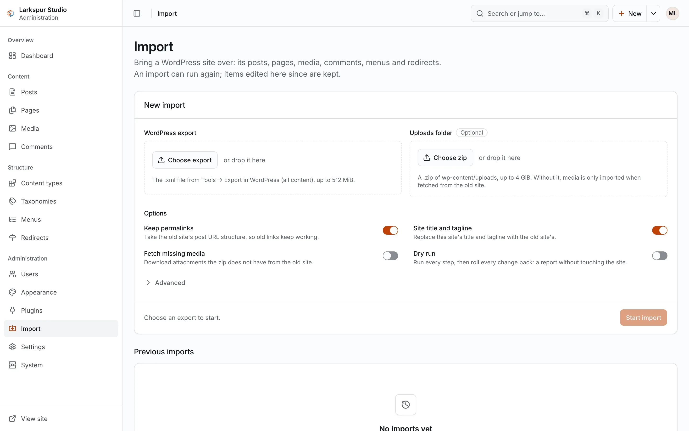

+++
description = "Move a WordPress site's content, media, users and old addresses into FerriteCMS."
+++

# Import from WordPress

FerriteCMS imports a WordPress export file (WXR). It brings over content, not code:
WordPress plugins and themes do not run here.

## What comes over

- posts and pages, with their hierarchy, order, statuses and dates; custom post types
  become content types;
- attachments, as media items with their alt text;
- categories, tags and custom taxonomies, with their parents;
- authors, matched to existing users by e-mail, then login, or created as authors;
- comments, with their threading and status;
- menus (one per WordPress menu; you assign the theme locations afterwards);
- the site title and description;
- Yoast and Rank Math SEO titles, descriptions, canonical URLs and robots settings;
- featured images, and ACF fields on custom post types;
- **301 redirects** from the old address of each published item, category and tag (and
  each attachment page) whose address changed.

Gutenberg blocks, the classic editor's HTML and the common shortcodes (`[caption]`,
`[gallery]`, `[embed]`, `[video]`, `[audio]`) are converted to the editor's blocks.
Anything that could not be converted is listed in the report.

Imported users have no password: WordPress exports carry none. Each must set one with a
password reset, or an admin sets it (`ferrite user reset-password`).

## Export from WordPress

In WordPress, **Tools → Export** downloads the export file. For the media, copy the old
site's `wp-content/uploads` folder, or make a `.zip` of it.

## Try a dry run first

A dry run does everything and then rolls every write back, so you can read the report
before you commit to anything (with SQLite, stop `serve` first):

```sh
ferrite import wordpress export.xml --data ./mysite --uploads ./uploads --dry-run
```

## Run the import

```sh
ferrite import wordpress export.xml --data ./mysite --uploads ./uploads
```

Useful options (all in `ferrite import wordpress --help`):

| Option | Effect |
|---|---|
| `--uploads DIR\|ZIP` | the old `wp-content/uploads` folder, or a `.zip` of it, read in place |
| `--fetch-media` | download attachments that are missing from `--uploads` from the old site |
| `--no-keep-permalinks` | keep this site's post address structure instead of taking the old one |
| `--no-site-options` | do not import the site title and description |
| `--category-base B`, `--tag-base B` | the old site's category and tag bases, for redirects (default `category` and `tag`) |
| `--as LOGIN` | the admin the import runs as (default: the first active admin) |
| `--report DIR` | where to write the report |

The exit code is 0 when everything came over, 2 when it finished but some redirects or
media were refused or missing (the report lists them), 3 when another import is running
and 1 on an error.

The resized copies of imported images are made by the next `ferrite serve`.

## Import from the admin

With the server running, an admin can open **Import** (`g i`), drop the export file and,
optionally, a `.zip` of the uploads, choose the options and start. The import runs in the
background; the screen shows its progress, and the report opens from the list of runs.

<figure><figcaption>The Import screen.</figcaption></figure>

## The report

Each run writes `report.json` and `report.html` to
`<data>/import/reports/<run-id>/` (or `--report DIR`). It counts what was created,
updated, unchanged, kept and skipped per kind, and lists unknown blocks and shortcodes,
missing media, redirects made and refused, slugs that had to change, users who need a
password, and what the conversion dropped.

## Run it again

Running the import again with the same site's export updates what changed in WordPress
since the last run, and **keeps** every item that was edited here since the import wrote
it (the report counts those as "kept"). Terms are matched, not updated. This lets you
import, check the result, and import once more just before you switch over.

The import knows a site by the export's `<wp:base_blog_url>`, which must be an
`http://` or `https://` address (WordPress always writes one). A file with anything else
there is refused before anything is written, with exit 1 and the message "is not an
http(s) URL". If you edit that value, the import treats the file as a different site: a
site you imported from such a file before would get its posts, pages, media, comments
and menus a second time. Delete what the first import made, or import into a fresh site,
or keep the first import and do not run it again.
