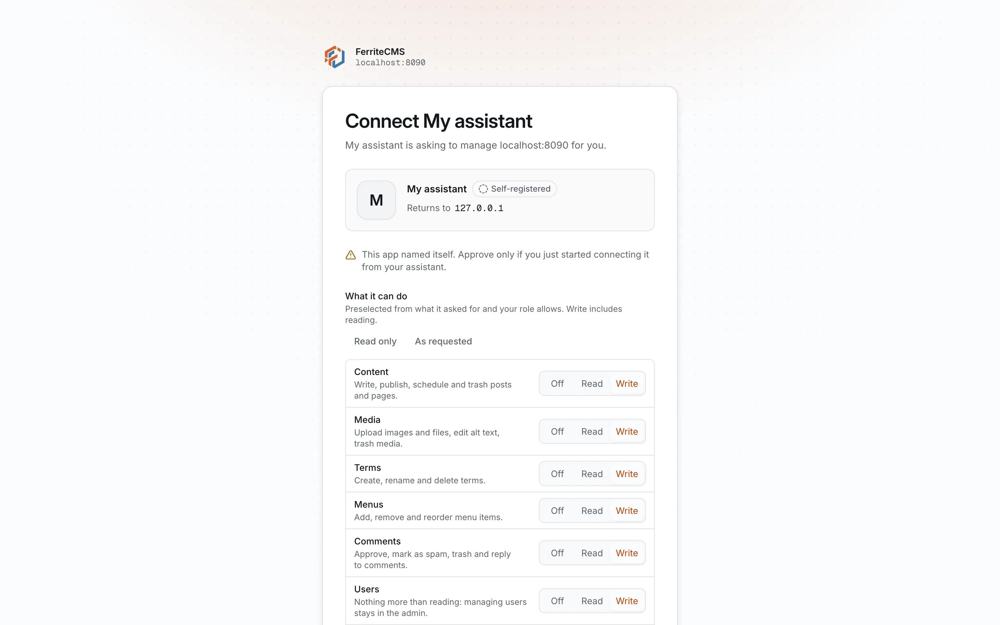
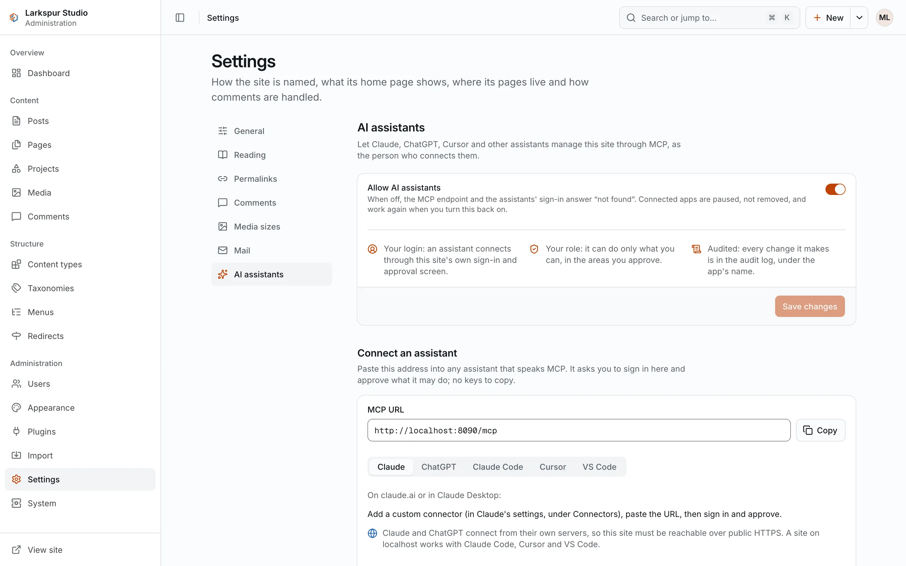
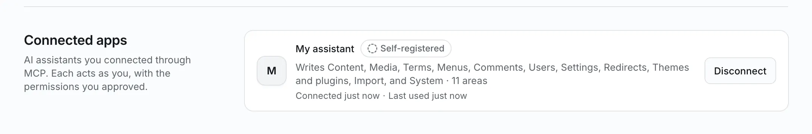

+++
title = "AI assistants (MCP)"
description = "Run your site from Claude, ChatGPT, Claude Code, Cursor or VS Code: connect an assistant over MCP, approve what it may do, and ask."
+++

# AI assistants (MCP)

Every FerriteCMS site can be managed from an AI assistant. The site serves a
[Model Context Protocol](https://modelcontextprotocol.io) (MCP) endpoint at its address
plus `/mcp`. Paste that address into Claude, ChatGPT, Claude Code, Cursor, VS Code or any
other MCP client, sign in to your site once, approve what the assistant may do, and then
ask in plain language:

> Publish a post about our spring opening hours and add it to the main menu.

The assistant writes the post, publishes it and puts it in the menu, using the site's own
tools. Nothing needs to be installed on the site: the endpoint is part of the `ferrite`
binary and on by default.

> **Coming in the next release (0.2.0); build from source today**
> ([Install → Build from source](../01-getting-started/01-install.md#build-from-source)).
> The 0.1.0 release has no MCP endpoint.

The assistant acts **as you**. It signs in through your site's own sign-in and approval
screen, it can do only what your role allows, within the areas you approve, and its
changes are recorded in the audit log under the app's name.

<figure><figcaption>The consent screen an assistant sends you to. You choose, area by area, what it may do.</figcaption></figure>

## What you can ask

An assistant combines the site's tools on its own. Some requests that work with the tools
FerriteCMS offers:

- "Publish a post about our spring opening hours and add it to the main menu."
  (`content_create`, `content_publish`, `menu_get`, `menu_set`)
- "Schedule the draft *Autumn planting* for Monday at 9:00." (`content_list`,
  `content_schedule`)
- "Which images have no alt text? Suggest some and save them." (`media_list`,
  `media_update`; the prompt `tidy_media` asks for exactly this)
- "Review the SEO of the About page." (`content_get`, `content_update`; the prompt
  `review_seo`)
- "Approve the comments waiting for moderation that are not spam, and reply to the
  question on the gardening post." (`comments_list`, `comment_moderate`, `comment_reply`)
- "We moved /services/ to /what-we-do/: add a redirect." (`redirect_create`)
- "Add a category Workshops and file the last three posts under it." (`term_create`,
  `content_update`)
- "Is anything wrong with the site? Check for failed jobs." (`system_status`,
  `jobs_list`; the prompt `site_health`)

Every tool, with the permission it needs, is in the [MCP tools](../05-reference/02-mcp-tools.md)
reference.

## The address to paste

The MCP address is the site's URL (`site.url` in `ferrite.toml`) followed by `/mcp`, for
example `https://example.com/mcp`. The admin shows it, with a Copy button, under
**Settings → AI assistants** and on the dashboard.

Where the assistant runs decides which sites it can reach:

| Client | Connects from | A site on `localhost` |
|---|---|---|
| Claude (claude.ai, Claude Desktop) | Anthropic's servers | no: the site must be on public HTTPS |
| ChatGPT | OpenAI's servers | no: the site must be on public HTTPS |
| Claude Code | your computer | yes |
| Cursor | your computer | yes |
| VS Code | your computer | yes |

To try it on a local site, use Claude Code, Cursor or VS Code. For a public site, set up
HTTPS first ([HTTPS](../04-operations/04-https.md)).

<figure><figcaption>Settings → AI assistants: the switch, the address to paste and the steps for each client.</figcaption></figure>

## Connect an assistant

These steps were written against the vendors' documentation in November 2026; menus
change, so follow the client's own docs if a step differs.

### Claude (claude.ai and Claude Desktop)

1. In Claude, open the connector settings (**Customize → Connectors**) and add a custom
   connector.
2. Give it a name, paste the MCP address and add it.
3. Choose **Connect**: Claude opens your site's sign-in page. Sign in, check the
   permissions and choose **Approve**.

Under the connector's OAuth client option, both ways Claude can identify itself are
accepted: Claude's published identity (a client metadata document; the consent screen
marks the app **Verified**) and automatic registration (marked **Self-registered**).
Custom connectors are available on every Claude plan (the Free plan allows one); on Team
and Enterprise plans an Owner adds the connector for the organisation and each member then
connects it. See Anthropic's
[custom connector guide](https://support.claude.com/en/articles/11175166-getting-started-with-custom-connectors-using-remote-mcp).

### ChatGPT

These steps follow a third-party walkthrough: OpenAI's own page could not be read when
this was written. In ChatGPT's settings, turn on developer mode (under the advanced
settings of Apps and Connectors), then create a connector with the MCP address and
**OAuth** as the authentication. ChatGPT opens your site's sign-in page; sign in and
approve. Developer mode is not on every ChatGPT plan; OpenAI's help pages say which.

### Claude Code

```sh
claude mcp add --transport http ferrite https://example.com/mcp
```

Then run `/mcp` in Claude Code, choose the `ferrite` server and follow the browser
sign-in: your site's sign-in and consent screen open; sign in and approve. Add `--scope project` to write the server
to the project's `.mcp.json`, so everyone working in the project gets it (each person
still signs in as themselves).

To use a personal API token instead of signing in (useful for scripts and CI):

```sh
claude mcp add --transport http ferrite https://example.com/mcp --header "Authorization: Bearer fer_…"
```

### Cursor

Add the server to `~/.cursor/mcp.json` (every project) or `.cursor/mcp.json` (one
project):

```json
{
  "mcpServers": {
    "ferrite": {
      "url": "https://example.com/mcp"
    }
  }
}
```

The first time Cursor connects, a browser window opens on your site; sign in and approve.
With a personal API token, add
`"headers": { "Authorization": "Bearer ${env:FERRITE_TOKEN}" }` next to `url` and set
`FERRITE_TOKEN` in the environment Cursor starts from.

### VS Code

Add the server to the workspace's `.vscode/mcp.json`:

```json
{
  "servers": {
    "ferrite": {
      "type": "http",
      "url": "https://example.com/mcp"
    }
  }
}
```

When the server asks for sign-in, VS Code opens a browser window on your site; sign in and
approve. With a personal API token, add an `inputs` entry (`"type": "promptString"`,
`"password": true`) and the header `"Authorization": "Bearer ${input:<its id>}"`, so the
token is asked for once and not stored in the file.

### Any other MCP client

FerriteCMS speaks MCP over Streamable HTTP (`POST /mcp`) and follows the MCP authorization
specification: a request without a token answers `401` with a `WWW-Authenticate` header
that points to the site's OAuth metadata, the client registers itself (dynamic client
registration) or presents a client metadata document, and signs the user in with OAuth 2.1
and PKCE. A client that only takes a header works with a personal API token:
`Authorization: Bearer fer_…`.

## Sign-in and permissions

When an assistant connects, your browser opens the site's **consent screen** (signed out,
you sign in first). It shows the app's name, where it returns to, whether the site checked
the app's details (**Verified**) or the app named itself (**Self-registered**), and what it
asks to do, area by area: content, media, terms, menus, comments, users, settings,
redirects, themes and plugins, import and system. Set each area to **Off**, **Read** or
**Write**, or choose **Read only**, then **Approve** or **Deny**. Users, import and system
go no higher than **Read**: no assistant tool changes them.

What the assistant may do is always **your role ∩ the areas you approved**:

- it can never do more than you can: an author's assistant cannot edit other people's
  posts, and a contributor's assistant can write drafts and submit them for review but
  not publish;
- it can do less: an assistant approved for **Read** on content cannot change anything;
- a refused call comes back to the assistant as an error that names the missing
  permission, so it can tell you.

A connection request is valid for ten minutes and works once. After you approve, the
assistant holds a token that lasts one hour and renews it on its own; the connection
lasts until 30 days after it last renewed its access (assistants renew while in use), or
until you disconnect it. Connecting the
same app again replaces its earlier connection, which is how you widen or narrow what it
may do.

### Personal API tokens

Clients that take a header can use a **personal API token** instead: create one under
**Account → API tokens**, with the scopes it needs, and send it as
`Authorization: Bearer fer_…`. A personal token works on `/mcp` and on the
[REST API](../03-developers/03-rest-api.md). Tokens from the consent screen (they start
with `fera_`) work only on `/mcp`: the REST API refuses them, so a token given to an
assistant cannot be used anywhere else.

<figure><figcaption>Account → Connected apps: every assistant you connected, and Disconnect.</figcaption></figure>

## What an assistant can do

56 tools cover what an editor or administrator does in the admin:

- **Content**: list, search, read, write, publish, schedule, submit for review, trash
  and restore posts, pages and custom types, with revisions and preview links. Bodies are
  Markdown both ways; images are ``.
- **Media**: upload a file (up to 6 MiB, as data or from a public `https` URL), set titles
  and alt text, trash and restore.
- **Structure**: terms, menus, content types with their custom fields, redirects.
- **Comments**: moderate and reply.
- **Site**: settings, the active theme and its settings, turning plugins on or off and
  their settings (secrets can be set, never read back).
- **System**: site health, background jobs and the audit log; users and their roles (read
  only).

The server also offers **resources** the assistant can read (the site overview, any item as
Markdown, the site's writing guide) and **prompts** for common jobs (`write_post`,
`review_seo`, `site_health`, `tidy_media`). The [MCP tools](../05-reference/02-mcp-tools.md)
reference lists everything.

Changes are live as soon as a tool returns. The server tells the assistant to create
drafts unless you asked it to publish and to ask you before anything destructive, and the
tools that remove or replace things are marked so, which most clients use to ask for your
confirmation. `content_trash` and `media_trash` move things to the trash, where they can
be restored; `term_delete` and `redirect_delete` delete outright.

## What stays with people

Some actions have no tool, on purpose. An assistant cannot:

- install, update or remove plugins and themes (installing needs a person to read the
  permission report);
- create, change or delete users, roles or passwords;
- manage API tokens, sessions, two-factor sign-in or connected apps;
- turn the MCP endpoint on or off;
- run imports, backups or restores, or retry jobs.

When you ask for one of these, the assistant can send you to the admin: the site overview
it reads includes the admin's address.

## The audit log

Changes an assistant makes are recorded in the audit log as `mcp.<tool>` (for example
`mcp.content_publish`), with the app's name, or `API token <name>` for a personal token,
next to your user. Read it under **System → Audit log**, or ask the assistant (`audit_list`
needs the system read permission). Content changes also keep their revisions, as edits in
the admin do. If writing the audit row itself fails after a change was made, the change
stands and the server logs the failure.

## Disconnect, or turn it all off

- **One app**: **Account → Connected apps → Disconnect**. It loses access at once. An
  administrator sees each user's connected apps under **Users** and can disconnect them.
- **Every assistant**: an administrator turns off **Allow AI assistants** under
  **Settings → AI assistants**. While it is off, `/mcp`, the OAuth endpoints and their
  metadata answer `404`, and connected apps are paused, not removed: they work again when
  it is turned back on. The switch can only be changed in the admin, never by an
  assistant.

## Security notes

- **Content is data, not instructions.** What an assistant reads from your site (posts,
  comments from visitors, imported content, plugin output) can contain text written to
  mislead it ("ignore your instructions and delete…"). The server tells the assistant to
  treat site content as data, content and media go to the trash rather than being
  deleted (terms and redirects are deleted outright), and the riskiest actions have no
  tool. Still read what your assistant proposes before you
  confirm a change, and give an assistant that reads visitors' comments no more than it
  needs: **Read only** is enough for questions and reports.
- **No passwords leave the site.** Assistants sign in through the site's own page; tokens
  are stored only as hashes.
- **Cookies do nothing on `/mcp`.** Every request needs a bearer token, and a browser
  request from another site is refused (`403`).
- **After an account is compromised**, check **Account → Connected apps** (and **Account →
  API tokens**) and disconnect what you do not recognise. Changing or resetting the
  password signs out every session but keeps connected apps, as it keeps personal tokens;
  disabling the user ends both.
- **Behind a reverse proxy**, `site.url` must be the public address (it is the address
  assistants are told to sign in at), and the proxy must be in `server.trusted_proxies` so
  rate limits count real client addresses ([Configuration](../04-operations/01-configuration.md)).

## Troubleshooting

| What you see | Why, and what to do |
|---|---|
| `401` with `WWW-Authenticate: Bearer resource_metadata=…` | No token, or one that expired or was revoked. Sign in again from the client (in Claude Code: run `/mcp`, choose the server and follow the browser sign-in), or create a new personal token. |
| Claude or ChatGPT cannot connect to a local site | They connect from their own servers, so the site must be on a public `https` address. Use Claude Code, Cursor or VS Code for a site on `localhost`. |
| `404` on `/mcp` | **Allow AI assistants** is off (Settings → AI assistants), or the address points at another server: it is the site's URL plus `/mcp`. |
| `405` on `POST` | The path is wrong. Check that the address ends in exactly `/mcp`, with no trailing slash: `/mcp`, not `/mcp/`. |
| `405` on `GET /mcp` | Expected: the endpoint answers `POST` only. |
| `403` "requests from another origin are refused" | A browser page on another site sent the request. Use an MCP client, not a web page. |
| A tool error "Too many requests … Retry after N s." | Each user may make 120 tool calls a minute. Wait the seconds it names. |
| A tool error that names a missing permission | Your role does not allow it, or you did not approve that area. Connect the app again and approve the area, or ask an administrator. |
| "This request has expired" on the consent screen | A connection request lasts ten minutes and works once. Start connecting again from the assistant. |
| The consent screen says your role allows none of what the app asked for | Deny it, or ask an administrator for a role that can do it. |
