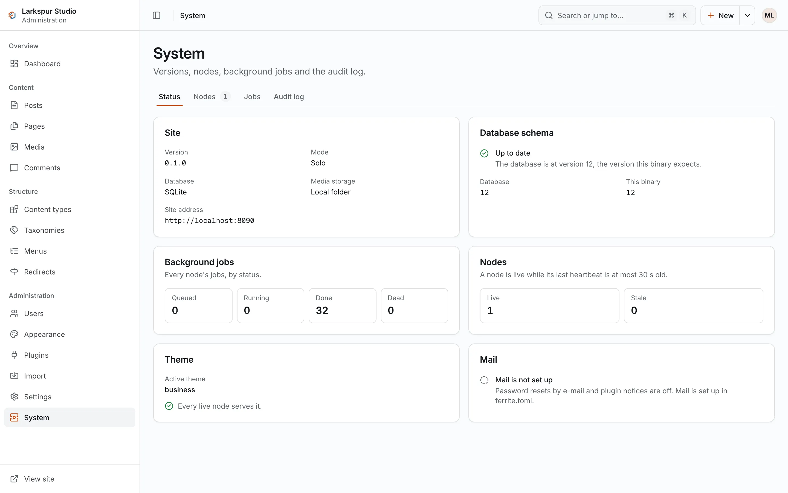

+++
description = "Watch a FerriteCMS site: health endpoints, Prometheus metrics, the traffic series, logs and ferrite doctor."
+++

# Monitoring

## Health endpoints

| Path | Answers |
|---|---|
| `/healthz` | `200 ok` while the process serves |
| `/readyz` | `200` when a database read succeeds (within 2 s) and the startup migration check passed, else `503` |

`ferrite healthcheck` probes one for container health checks: exit 0 on a `200`, 1 on
anything else. It speaks plain HTTP only.

```sh
ferrite healthcheck --url http://127.0.0.1:8080/readyz
```

`http://127.0.0.1:8080/readyz` is the default `--url`.

## Prometheus metrics

Metrics are off by default. Give them an address of their own; they are never served on
`server.listen`, and they need no sign-in, so keep the address private:

```toml
[server]
metrics_listen = "127.0.0.1:9464"
```

`GET http://127.0.0.1:9464/metrics` then answers in the Prometheus text format:

| Metric | Type | Labels |
|---|---|---|
| `ferrite_build_info` | gauge | `version`, `target` |
| `ferrite_http_requests_total` | counter | `class` (`page`, `api`, `admin`, `media`, `plugin`, `preview`, `other`), `status` (`2xx` … `5xx`) |
| `ferrite_http_request_duration_seconds` | histogram | `class` |
| `ferrite_page_views_total` | counter | successful public page views, without bots, previews and signed-in visitors |
| `ferrite_page_cache_hits_total`, `ferrite_page_cache_misses_total` | counter | |
| `ferrite_page_cache_entries`, `ferrite_page_cache_bytes` | gauge | |
| `ferrite_plugin_hook_calls_total`, `ferrite_plugin_hook_failures_total` | counter | `plugin`, `hook` |
| `ferrite_plugin_hook_duration_seconds` | histogram | `plugin`, `hook` |
| `ferrite_jobs` | gauge | `status` |
| `ferrite_db_pool_connections` | gauge | `state` (`idle`, `used`) |
| `ferrite_nodes` | gauge | the live nodes of the site |

Each node serves its own counters; `ferrite_jobs` and `ferrite_nodes` describe the whole
site.

## The traffic series

Each node also writes one row of counts per minute into the database. The admin's
dashboard shows them as **Site traffic**, and the API serves them (scope `system:read`):

```sh
curl -s -H "Authorization: Bearer $TOKEN" \
  'http://localhost:8080/api/v1/system/metrics/series?from=2026-10-31T00:00:00Z&to=2026-10-31T23:59:00Z&step=hour'
```

`step` is `minute`, `hour` or `day`, and `node` limits the series to one node. Each
bucket has requests, 5xx errors, page views, cache hits and misses, plugin calls and
failures, finished and failed jobs, and the 95th percentile page time. `GET
/api/v1/system/status` gives the version, the mode, the schema and the job counts.

## Logs

Logs go to standard error. `FERRITE_LOG` sets the level (`error`, `warn`, `info` (the
default), `debug`, `trace`) or a filter such as `FERRITE_LOG=info,ferrite_http=debug`.

<figure><figcaption><strong>System</strong> in the admin shows the nodes, background jobs and the audit log.</figcaption></figure>

## ferrite doctor

`ferrite doctor` checks a site and reports what is wrong, changing nothing: it creates
no local file, folder, key or schema, works while `serve` runs and never prints a
secret. With S3 media it writes, reads and deletes one probe object under `tmp/`, as
`serve` does at start (not with `--offline`).

```sh
ferrite doctor --data ./mysite
ferrite doctor --data ./mysite --offline
```

`--offline` skips the checks that reach other services (S3, SMTP, the ACME directory,
the release lookup). The database is still opened, which on Postgres is a network
connection, and a running node's own listeners are still probed (`net.listen`).

It prints one line per check, `<status>  <check>  <detail>`, the status one of `ok`,
`info`, `warn`, `error` or `skip`, and then a summary line. The 26 checks:

| Area | Checks |
|---|---|
| Binary and config | `version.binary`, `config.load` |
| Files | `fs.data_dir`, `fs.config_file`, `fs.secret_key`, `fs.database_files`, `fs.backups_dir`, `fs.themes_dir` |
| Database | `db.lock_state`, `db.connect`, `db.schema`, `db.identity`, `webhooks.endpoints` |
| Upgrades | `upgrade.record` |
| Media | `media.store`, `media.owner` |
| Clock and cluster | `clock.db_skew`, `clock.peers`, `cluster.versions`, `cluster.site_url` |
| Network services | `smtp.connect`, `tls.dir`, `tls.acme_directory`, `net.listen` |
| Backups and releases | `backup.target`, `release.latest` |

| Exit | Meaning, first match wins |
|---|---|
| 3 | the database's schema is newer than this binary allows |
| 1 | at least one check is an error |
| 2 | at least one check is a warning |
| 0 | none of the above |

`webhooks.endpoints` warns when a webhook was disabled automatically (its receiver
answered `410` or kept failing for 5 days), has been failing for more than 24 hours or is
paused on a copied database, and when `[webhooks] local_targets` is on; it names webhooks
and hosts only, never a URL's path ([Webhooks](../02-guides/09-webhooks.md)).

For example, a data folder that others can read gives `warn  fs.data_dir … chmod o-rwx
(0750 is recommended)`, and a `ferrite.toml` readable by others gives `warn
fs.config_file … chmod 600 it`.
